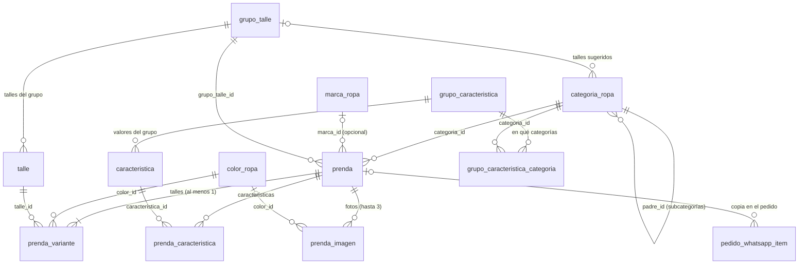

# Datos de las prendas: tablas, campos, relaciones y validaciones (`ROP`)

Complementa [catalogo.md](catalogo.md) (las reglas de negocio ROP-xx). Acá está **cómo se guarda** una prenda:
qué tablas intervienen, qué campos tiene cada una, de qué tipo, qué relaciones hay y qué se valida antes de
guardar. Revisado contra la base local el 2026-11-13 (`information_schema`).

## Objetivo

Que cualquiera que toque el catálogo sepa qué tabla administra cada dato de una prenda y qué controles tiene,
sin leer el código.

## Qué es una "prenda"

Un **modelo en un color** (ROP-29): "Remera Fortaleza Taverniti · Blanco" es una prenda; la misma remera en
negro es otra prenda (con el mismo nombre y marca, se agrupan en "También en:", ROP-30). Cada prenda tiene sus
**talles** (variantes), hasta **3 fotos**, **características** y **un precio**.

## Mapa de tablas

| Tabla | Qué guarda | Quién la administra |
| --- | --- | --- |
| `prenda` | La prenda (modelo + color): nombre, precio, categoría, marca, si se ve. | Panel → Prendas |
| `prenda_variante` | Cada talle de la prenda, con "hay" o "agotado". | Panel → Prendas (paso "Color y talles") |
| `prenda_imagen` | Las fotos (URL y orden). | Panel → Prendas (paso "Fotos") |
| `prenda_caracteristica` | Qué características tiene la prenda (tabla puente). | Panel → Prendas (paso "Características") |
| `categoria_ropa` | Árbol de categorías (Mujer › Remeras…). | Panel → Categorías |
| `marca_ropa` | Marcas. | Panel → Marcas |
| `color_ropa` | Colores con su muestra. | Panel → Colores |
| `grupo_talle` / `talle` | Grupos de talles y sus talles en orden. | Panel → Talles |
| `grupo_caracteristica` / `caracteristica` | Grupos (Material, Calce…) y sus valores. | Panel → Características |
| `grupo_caracteristica_categoria` | En qué categorías se ofrece cada grupo (ROP-59). | Panel → Características |
| `pedido_whatsapp_item` | Copia de la prenda en cada pedido (nombre, color, talle, precio). | Lo escribe el pedido; no se edita |

Todas viven en el schema del proyecto (`BD_ESQUEMA`) y tienen `id integer` autoincremental como clave.
Tipos según PostgreSQL: `varchar(n)` = texto de hasta n caracteres, `numeric(12,2)` = importe con 2
decimales (hasta 9.999.999.999,99), `timestamptz` = fecha y hora con zona.

## Tablas de la prenda

### `prenda`

| Campo | Tipo | Nulo | Por defecto | Restricción / relación | Para qué |
| --- | --- | --- | --- | --- | --- |
| `id` | integer | no | autoincremental | clave | |
| `nombre` | varchar(120) | no | | | Nombre del modelo (ej. "Jean Howie Taverniti"). |
| `slug` | varchar(90) | no | | **único** | Dirección de la ficha: nombre + color ("jean-howie-taverniti-azul"). Lo arma el servidor. |
| `descripcion` | text | no | `''` | | Texto libre de la ficha. |
| `categoria_id` | integer | no | | → `categoria_ropa.id` (borrar: no se permite) | Dónde aparece en la tienda. |
| `marca_id` | integer | **sí** | | → `marca_ropa.id` (borrar: queda vacía) | Marca, opcional. |
| `grupo_talle_id` | integer | no | | → `grupo_talle.id` (borrar: no se permite) | De qué grupo salen sus talles. |
| `precio` | numeric(12,2) | no | | | Precio único para todos los talles (ROP-07). |
| `precio_anterior` | numeric(12,2) | **sí** | | | Si tiene valor, está en oferta y se muestra tachado (ROP-17). |
| `activo` | boolean | no | `true` | | Si se ve en la tienda. |
| `creado_en` | timestamptz | no | ahora (lo pone el servidor) | | Alta; ordena "Novedades". |
| `actualizado_en` | timestamptz | no | ahora (lo pone el servidor) | | Última edición; ordena el panel. |

Índices: `slug` (único), `categoria_id`, `activo`. **Código de Lince:** ver
[2026-11-codigo-lince.md](../cambios/2026-11-codigo-lince.md) (🚧 en aprobación).

### `prenda_variante` (talles)

| Campo | Tipo | Nulo | Por defecto | Restricción / relación | Para qué |
| --- | --- | --- | --- | --- | --- |
| `id` | integer | no | autoincremental | clave | Lo usa el pedido guardado en el navegador: **se conserva al editar** (ROP-08). |
| `prenda_id` | integer | no | | → `prenda.id` (borrar la prenda: se borran) | |
| `color_id` | integer | no | | → `color_ropa.id` (borrar el color: no se permite) | El color de la prenda (uno solo por prenda, ROP-29). |
| `talle_id` | integer | no | | → `talle.id` (borrar el talle: no se permite) | |
| `disponible` | boolean | no | `true` | | "Hay" (`true`) o "Agotado" (`false`). Un talle que no se vende no tiene fila. |

Índice único: (`prenda_id`, `color_id`, `talle_id`): el mismo talle no se repite.

### `prenda_imagen` (fotos)

| Campo | Tipo | Nulo | Por defecto | Restricción / relación | Para qué |
| --- | --- | --- | --- | --- | --- |
| `id` | integer | no | autoincremental | clave | |
| `prenda_id` | integer | no | | → `prenda.id` (borrar la prenda: se borran) | |
| `color_id` | integer | **sí** | | → `color_ropa.id` (borrar el color: no se permite) | Color de la foto (las prendas nuevas siempre lo cargan; vacío = foto general de prendas viejas). |
| `url` | varchar(500) | no | | | Dirección https (Cloudinary) o `/catalogo-inicial/…` en tu PC (ROP-34). |
| `orden` | smallint | no | `0` | | 0 = portada de la tarjeta. |

Índice: `prenda_id`. Al editar, las fotos **se reemplazan todas** (no conservan id).

### `prenda_caracteristica` (características)

| Campo | Tipo | Nulo | Restricción / relación |
| --- | --- | --- | --- |
| `id` | integer | no | clave |
| `prenda_id` | integer | no | → `prenda.id` (borrar la prenda: se borran) |
| `caracteristica_id` | integer | no | → `caracteristica.id` (borrar el valor: no se permite si una prenda lo usa) |

Índices: único (`prenda_id`, `caracteristica_id`) y `caracteristica_id`. Al editar se reemplazan (ROP-38).

## Tablas que la prenda usa (listas del panel)

| Tabla | Campos | Restricciones |
| --- | --- | --- |
| `categoria_ropa` | `nombre` varchar(80), `slug` varchar(90) **único**, `padre_id` → `categoria_ropa` (borrar: queda vacío), `grupo_talle_id` → `grupo_talle` (borrar: queda vacío), `orden` smallint (0), `activo` boolean (true), fechas | Índice `padre_id`. No se borra con subcategorías o prendas (servicio). |
| `marca_ropa` | `nombre` varchar(80) **único**, `activo` boolean (true), `logo_url` varchar(500) nulo, fechas | No se borra si la usa una prenda (servicio). |
| `color_ropa` | `nombre` varchar(40) **único**, `hex` varchar(7) (`#RRGGBB`), `orden` smallint, fechas | No se borra si lo usa una prenda. |
| `grupo_talle` | `nombre` varchar(40) **único**, `orden` smallint, fechas | No se borra si lo usa una prenda. |
| `talle` | `grupo_talle_id` → `grupo_talle` (borrar el grupo: se borran), `nombre` varchar(10), `orden` smallint | Único (`grupo_talle_id`, `nombre`). No se saca un talle que usa una prenda. |
| `grupo_caracteristica` | `nombre` varchar(40) **único**, `orden` smallint, fechas | No se borra con valores en uso. |
| `caracteristica` | `grupo_caracteristica_id` → `grupo_caracteristica` (se borran con el grupo), `nombre` varchar(40), `orden` smallint | Único (`grupo_caracteristica_id`, `nombre`). |
| `grupo_caracteristica_categoria` | `grupo_caracteristica_id`, `categoria_id` (se borra la fila si se borra cualquiera de los dos) | Único (los dos). Sin filas = el grupo se ofrece en todas las categorías. |

## Validaciones al guardar una prenda

Se valida dos veces: la **entrada** (esquema `esquemaPrenda` en `reglas.js`, mensajes en español) y las
**referencias** contra la base (`verificarReferencias` en `prendas_service.js`). El navegador nunca manda el
slug ni las fechas.

### Entrada (`esquemaPrenda`)

| Campo | Regla | Mensaje si falla |
| --- | --- | --- |
| `nombre` | Obligatorio, sin espacios a los costados, 1 a 120 caracteres. | "Escribí el nombre." / "Máximo 120 caracteres." |
| `descripcion` | Opcional, hasta 2000 caracteres (vacío = `''`). | |
| `categoria_id` | Número entero positivo. | "Elegí una categoría." |
| `marca_id` | Opcional (vacío = sin marca). | |
| `grupo_talle_id` | Número entero positivo. | "Elegí el grupo de talles." |
| `precio` | Mayor a 0, hasta 99.999.999. | "El precio tiene que ser mayor a 0." |
| `precio_anterior` | Opcional; si viene, **mayor que el precio**. | "El precio anterior tiene que ser mayor que el precio actual." |
| `activo` | Sí/no (por defecto sí). | |
| `variantes` | Entre 1 y 400; cada una con `color_id`, `talle_id` y `disponible`. **Un solo color** en toda la prenda. Sin talle repetido. | "Tildá al menos un talle y un color." / "Cada prenda es de un solo color…" / "Hay talles y colores repetidos." |
| `imagenes` | Hasta **3**; cada `url` https o `/catalogo-inicial/<archivo>.jpg/png/webp`; solo del color de la prenda. | "Hasta 3 fotos por prenda." / "Hay fotos de un color que la prenda no tiene." |
| `caracteristicas` | Hasta 60 ids; los repetidos se ignoran. | |

### Referencias (servidor, dentro de la misma transacción)

- La categoría, la marca (si viene), el grupo de talles, cada color y cada característica **existen**.
- Todos los talles son **del grupo elegido**.
- Error: código `DATOS_INVALIDOS` (400) con el motivo ("La categoría elegida no existe.", "Hay talles que no son
  del grupo elegido.", etc.).

### Lo que arma el servidor

- **Slug:** `nombre + color` sin tildes ni símbolos, hasta 80 caracteres; si ya existe, se agrega `-2`, `-3`…
  Se recalcula solo si cambian el nombre o el color.
- **Variantes al editar:** las que siguen **conservan su id**; las que se sacan se borran; las nuevas se crean.
- **Fotos y características al editar:** se reemplazan todas.
- **Fechas:** `creado_en` al crear; `actualizado_en` en cada cambio.

## Qué pasa al borrar

| Se borra… | Efecto |
| --- | --- |
| Una prenda | Se borran sus variantes, fotos y características. Los pedidos **no cambian**: guardan su copia y `pedido_whatsapp_item.prenda_id` queda vacío. |
| Una categoría | No se permite si tiene subcategorías o prendas. |
| Una marca | No se permite si la usa una prenda (si se forzara en la base, la prenda quedaría sin marca). |
| Un color, talle o característica | No se permite si lo usa una prenda (la base también lo impide). |
| Un grupo de talles o de características | No se permite si tiene valores en uso. |

## Qué ve cada uno

- **Tienda:** solo prendas `activo = true` de categorías visibles (activas ellas y todas las de arriba), sin
  `id` de base en la dirección (usa el slug). Los talles "agotados" se ven tachados y no se pueden pedir.
- **Panel:** todas (visibles y ocultas). La lista filtra por nombre, categoría (con subcategorías) y estado
  (ROP-09); la API acepta además marca, color, talle y características, pero la pantalla no los ofrece.

## Riesgos detectados (2026-11-13)

- ❓ **Índices únicos repetidos.** En la base local, `categoria_ropa` tiene 10 índices únicos sobre `slug`,
  `marca_ropa`/`color_ropa`/`grupo_talle` 10 sobre `nombre`, `grupo_caracteristica` 7 y `prenda` 7 sobre `slug`.
  Sequelize agrega uno nuevo cada vez que sincroniza un modelo con `unique: true` en la columna. No rompe datos,
  pero crece en cada deploy que cambia la base y hace más lentas las escrituras. Opciones: (a) pasar esos
  `unique: true` a un índice con nombre fijo (como ya se hizo en `grupo_caracteristica_categoria`) y borrar los
  repetidos al arrancar; (b) dejarlo. Recomendación: (a), como cambio aparte (probablemente también afecta tablas
  del core). **Respuesta:**

## Dónde está el código

- Modelos y relaciones: `servidor/src/modulos/tienda_ropa/models/index.js`.
- Validaciones de entrada: `servidor/src/modulos/tienda_ropa/reglas.js` (`esquemaPrenda`, `problemaFotos`, `slug`).
- Alta, edición, baja y filtros: `servidor/src/modulos/tienda_ropa/services/prendas_service.js`.
- Tienda (lo visible): `servidor/src/modulos/tienda_ropa/services/catalogo_service.js`.
- Formulario del panel: `frontend/src/modules/tienda_ropa/admin/prenda_form_page.jsx`.
